<div align="center">


# 🏛️ The Collegiate Registry

*Scientia · Veritas · Excellentia*

**An illustrated, interactive survey of 250 leading American universities.**
Compare them side by side, build a shortlist, see which are a **Reach**, **Target** or **Likely** for *you*, find the ones nearest home, and price out four years — all in a parchment-and-gold dossier you can take offline.

[](https://jaineil32624.github.io/The-Collegiate-Registry/)
[](https://github.com/jaineil32624/The-Collegiate-Registry/releases/latest/download/CollegiateRegistry.apk)
[](https://github.com/jaineil32624/The-Collegiate-Registry/releases/latest)


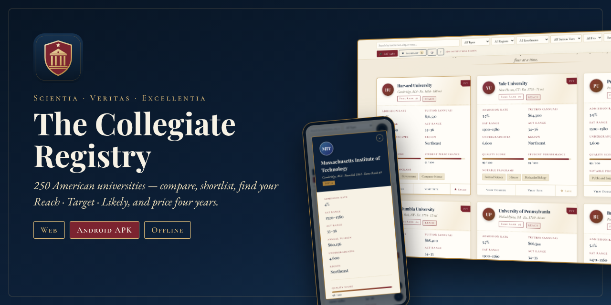

</div>

---

## ✨ What you can do

| | Feature | Details |
|---|---|---|
| 🗂️ | **Gallery of 250 dossiers** | Admission rate, SAT/ACT ranges, tuition, enrollment, quality & student-performance scores, notable programs |
| 🔍 | **Search, filter & sort** | By name, city or state · type (Ivy, Top 25, Public Elite, Liberal Arts) · region · size · tuition tier · fame, selectivity, quality… |
| 🎓 | **Reach / Target / Likely** | Enter your SAT or ACT once — every card is marked for you, and you can filter or sort by fit |
| 📏 | **Your standing gauge** | Each dossier shows exactly where your score sits against the middle-50% range |
| ★ | **Shortlist** | Save institutions with one tap; filter to just your list; saved cards glow gold on the gallery and atlas |
| 📍 | **Nearest to me** | Sort by distance from where you are, with miles shown on every card |
| 💵 | **Four-year cost estimator** | Slide grant aid and annual increase to see each year and the total |
| ⚖️ | **Side-by-side comparison** | Up to four institutions, with the leading value in each row marked ✦ and visual bars |
| 🗺️ | **The Atlas** | Every institution pinned on a map, coloured by region — click a pin for its dossier |
| ← → | **Dossier paging** | Flip through dossiers in your current filter order with the arrow keys |
| 🔗 | **Share links** | Link straight to a dossier (`#c=yale`) or a comparison (`#compare=harvard,mit,stanford`) |
| 🎲 | **Random institution** | Discover somewhere new |
| 🎻 | **Chamber music** | Ambient synthesized music (Web Audio, no files) |
| ⌨️ | **Keyboard** | `/` search · `S` shortlist · `R` random · `A` gallery/atlas · `C` compare · `?` guide |

> 📝 All figures are approximate, illustrative composites for exploration — always confirm with each institution's official site.

## 📸 Screenshots

<table>
<tr>
<td>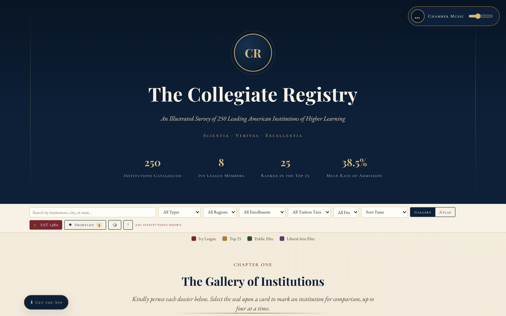<p align="center">🏛️ <b>The Registry</b></p></td>
<td>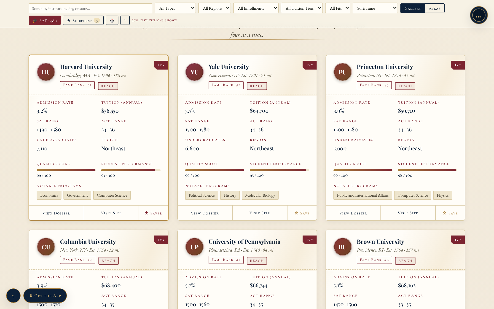<p align="center">🗂️ <b>Gallery</b> with your fit &amp; distance</p></td>
</tr>
<tr>
<td>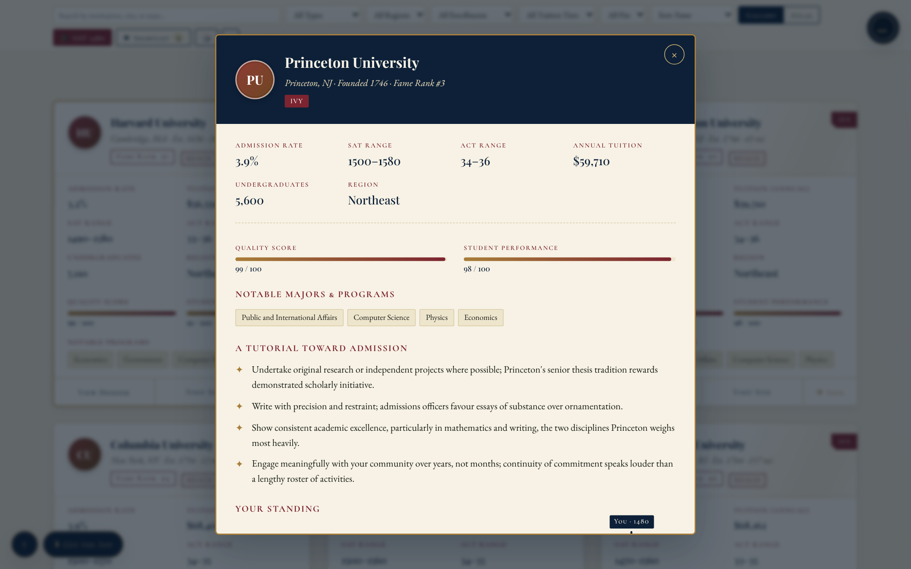<p align="center">📜 <b>Dossier</b></p></td>
<td>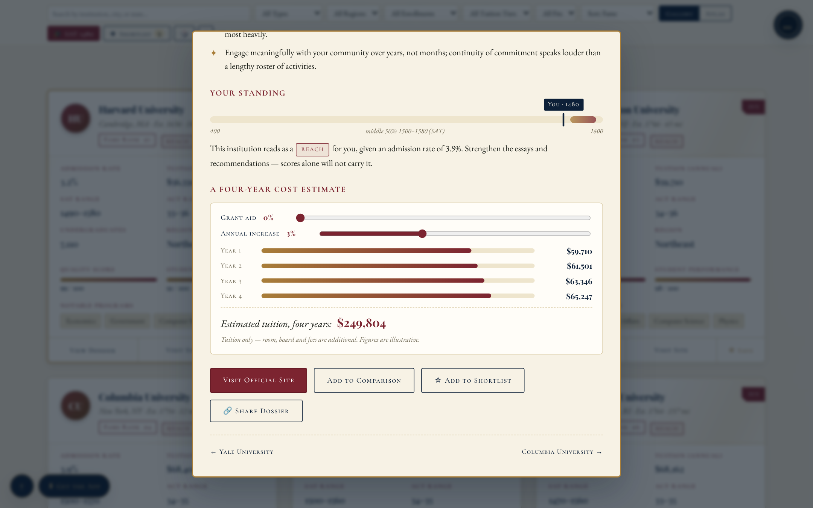<p align="center">📏 <b>Your standing</b> &amp; 💵 <b>cost estimator</b></p></td>
</tr>
<tr>
<td>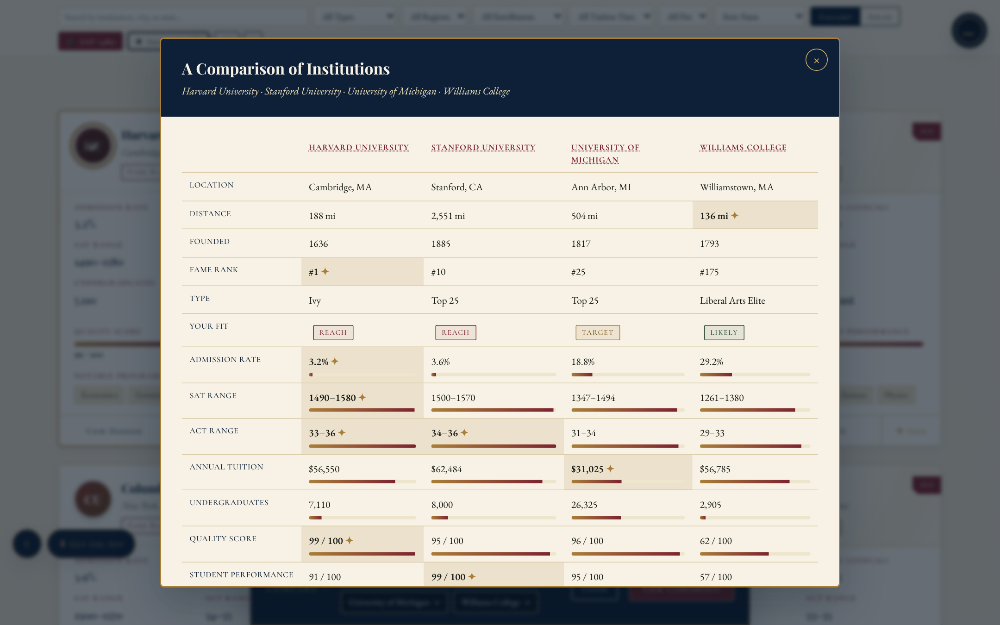<p align="center">⚖️ <b>Comparison</b> with leading values</p></td>
<td>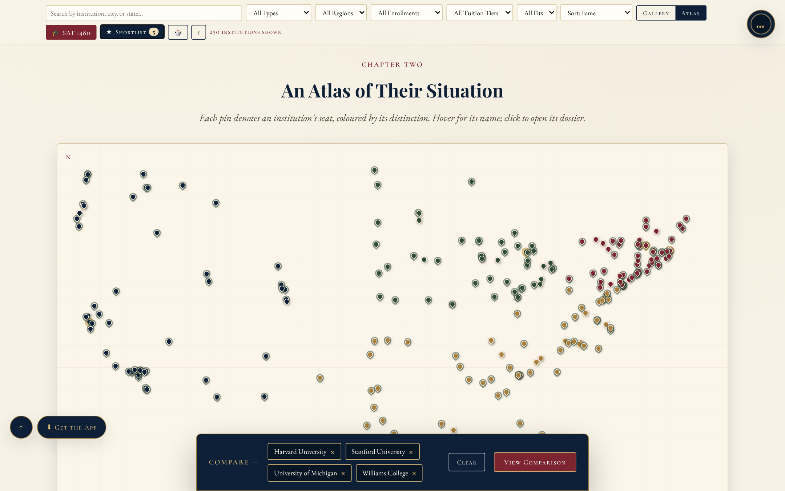<p align="center">🗺️ <b>The Atlas</b></p></td>
</tr>
<tr>
<td>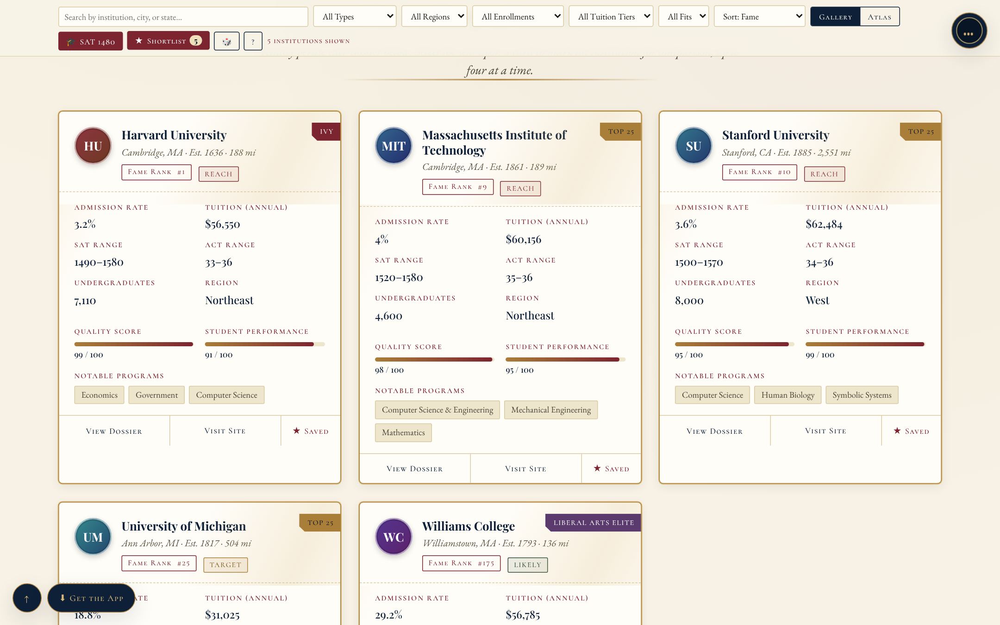<p align="center">★ <b>Your shortlist</b></p></td>
<td>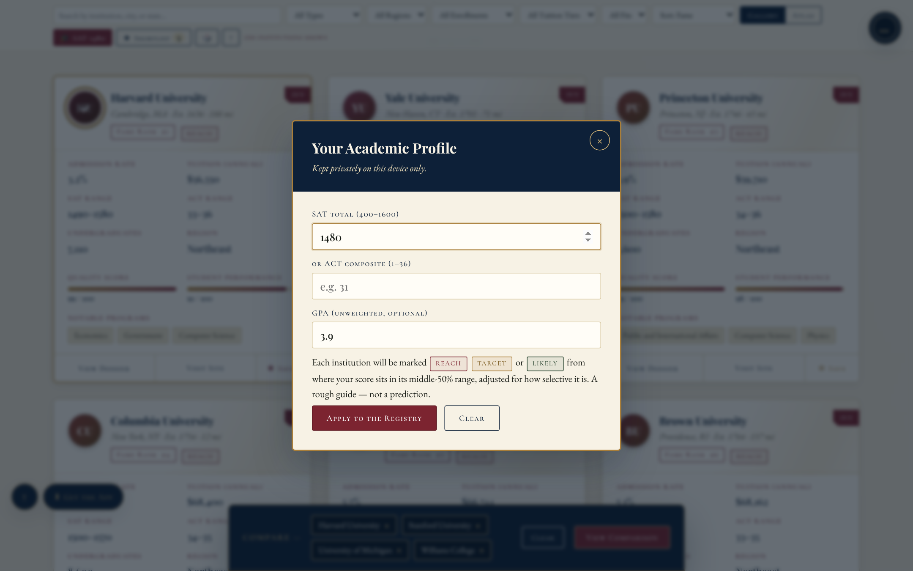<p align="center">🎓 <b>My Scores</b></p></td>
</tr>
</table>

<p align="center">
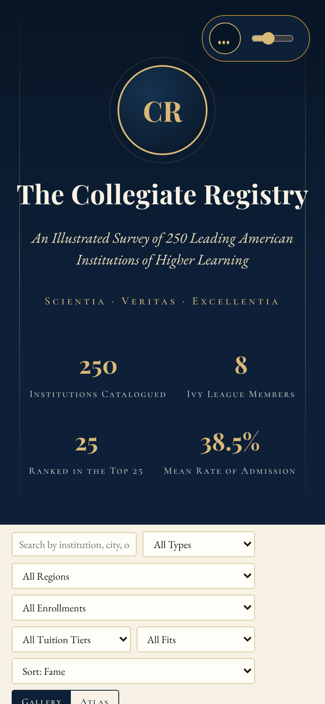
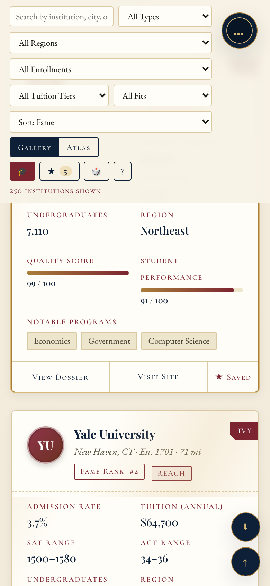
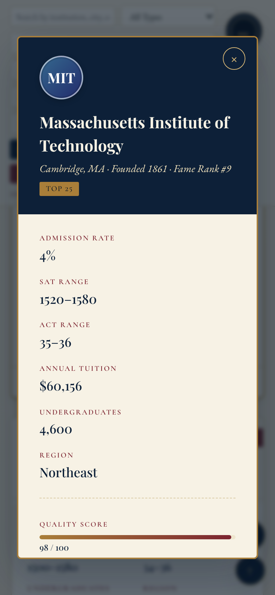
<br><em>📱 Fully responsive for phones and tablets</em>
</p>

## 📥 Get the Registry

| Platform | How |
|---|---|
| 🌐 **Web** | Open **[jaineil32624.github.io/The-Collegiate-Registry](https://jaineil32624.github.io/The-Collegiate-Registry/)** |
| 🤖 **Android** | Download **[CollegiateRegistry.apk](https://github.com/jaineil32624/The-Collegiate-Registry/releases/latest/download/CollegiateRegistry.apk)** → open it → allow *Install unknown apps* if asked |
| 💻 **Windows / Mac / Chromebook** | Open the site in Chrome or Edge → **⬇ Get the App** → **Install** |
| 🍎 **iPhone / iPad** | Open the site in Safari → **Share** → **Add to Home Screen** |
| 📦 **Offline zip** | Grab **CollegiateRegistry-web.zip** from [Releases](https://github.com/jaineil32624/The-Collegiate-Registry/releases/latest), unzip, open `index.html` |

> 🔒 Your scores and shortlist are stored only on your device. No account, no ads, no tracking.

## 🛠️ Run it locally

```bash
git clone https://github.com/jaineil32624/The-Collegiate-Registry.git
cd The-Collegiate-Registry
python3 -m http.server 8000      # then open http://localhost:8000
```

One `index.html` — no build step, no dependencies.

## 🗂️ Project structure

```
The-Collegiate-Registry/
├── index.html              🏛️ the whole app: data for 250 institutions, styles, logic, music
├── sw.js                   📴 offline service worker
├── manifest.webmanifest    📲 installable-app manifest
├── icons/                  🛡️ crest icons (SVG + PNG + maskable)
├── vendor/                 🔤 Playfair Display, EB Garamond & Cormorant SC, bundled for offline use
├── docs/screenshots/       📸 images for this README
├── VERSION                 🏷️ bump to publish a new release
└── .github/workflows/
    ├── release.yml         🤖 builds the Android APK + publishes a Release
    └── vendor.yml          ⬇️ refreshes the offline fonts
```

## 🚀 Releasing a new version

Bump the number in `VERSION` and push — GitHub Actions builds the APK and publishes the release automatically:

```bash
echo "1.1.0" > VERSION
git commit -am "Release 1.1.0" && git push
```

## ➕ Adding an institution

Add an object to the `COLLEGES` array in `index.html` with the same fields as its neighbours (`id`, `name`, `city`, `state`, `lat`, `lon`, `acceptance`, SAT/ACT ranges, `tuition`, `population`, `ranking`, `majors`, `website`, `badge`, `founded`, `quality`, `performance`, `region`, crest hues).

---

<div align="center">

Compiled with 📜, ☕ and a great many admission statistics by **[Jaineil Rana](https://github.com/jaineil32624)**

⭐ *If the Registry helped your search, kindly leave a star.* ⭐

</div>
